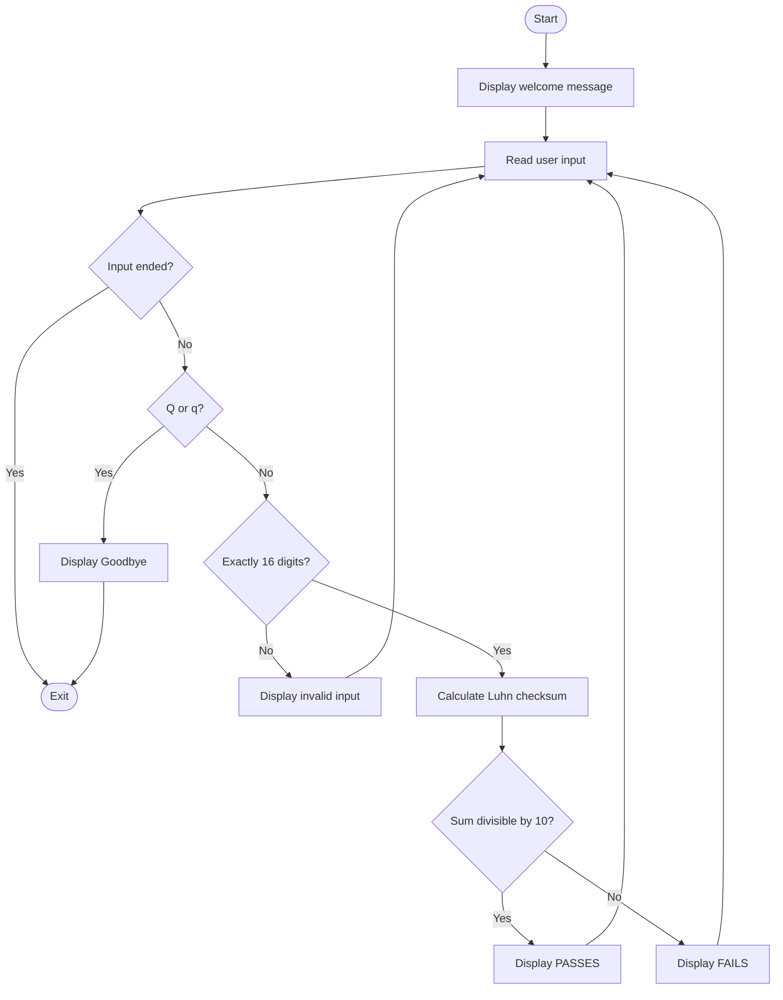
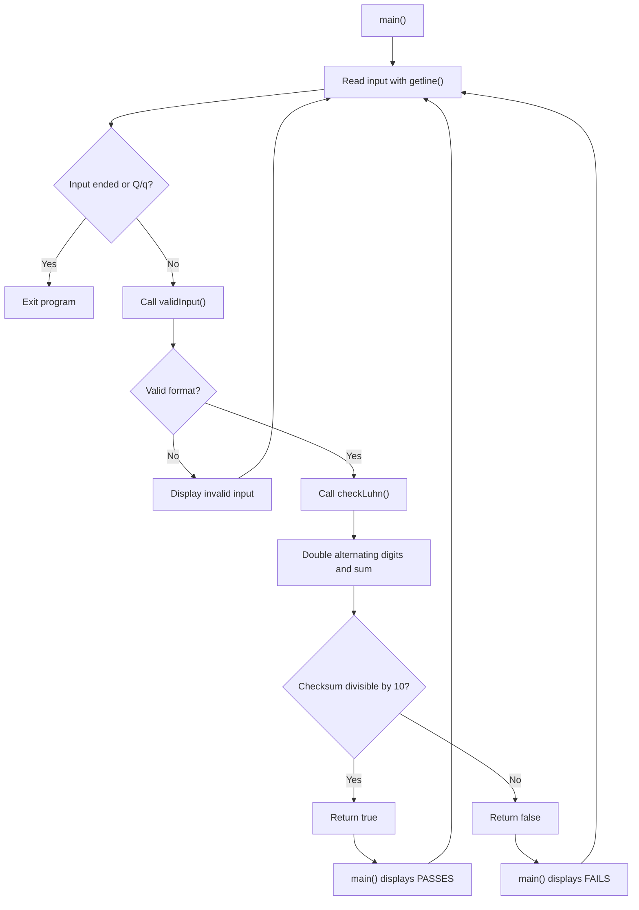

# Luhn Validation Flowchart

1. Start the program.
2. Display the welcome message.
3. Ask the user for a 16-digit number or Q to quit.
4. If input ends, exit cleanly.
5. If the user enters Q or q, display Goodbye and exit.
6. Otherwise, validate the input format.
7. If input is not exactly 16 numeric digits,
display an error and request another input.
8. If input is valid, calculate the Luhn checksum.
9. Starting from the rightmost digit, double
every second digit.
10. If a doubled value is greater than 9,
subtract 9.
11. Add all transformed digits.
12. If the sum is divisible by 10,
display "Luhn checksum PASSES!"
13. Otherwise, display "Luhn checksum FAILS!"
14. Return to the input prompt and repeat.

## Function Workflow

main()
- Reads input using getline()
- Checks for Q or q
- Calls validInput()
- Calls checkLuhn() for correctly formatted input
- Displays the result and repeats

validInput()
- Checks input length is exactly 16
- Checks every character is a digit
- Returns true or false

checkLuhn()
- Processes digits from right to left
- Doubles alternating digits
- Subtracts 9 from doubled values greater than 9
- Calculates the total sum
- Returns whether sum % 10 equals 0

## Luhn Program Flowchart

## Luhn Function Workflow Diagram

